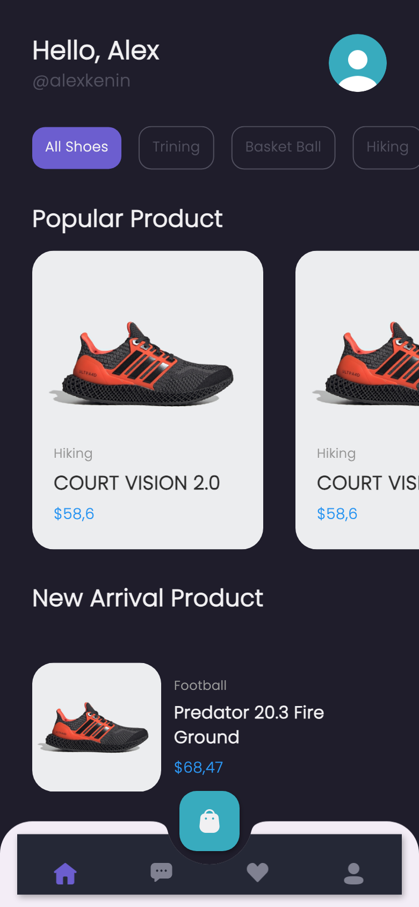
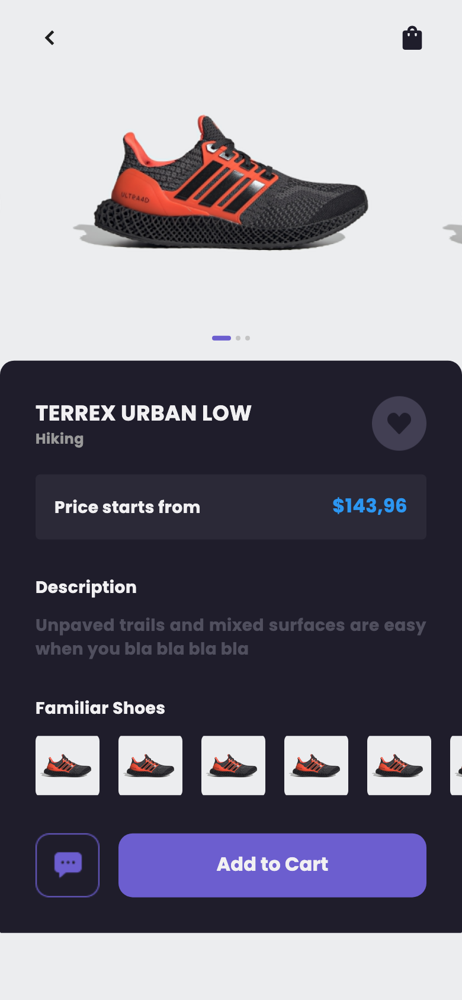
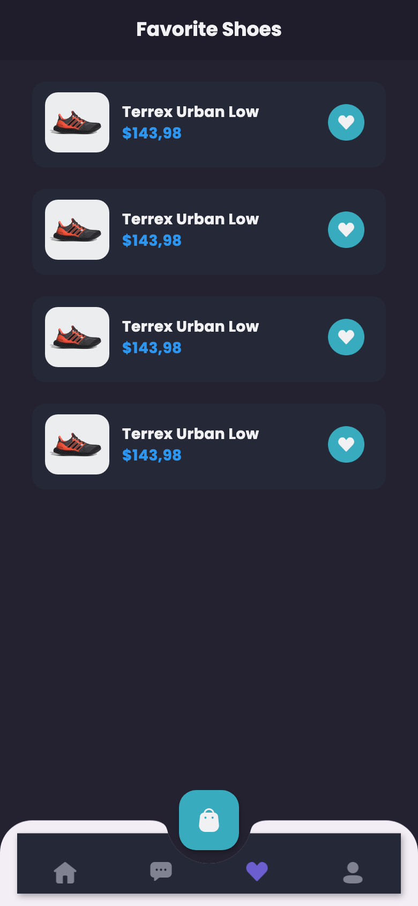
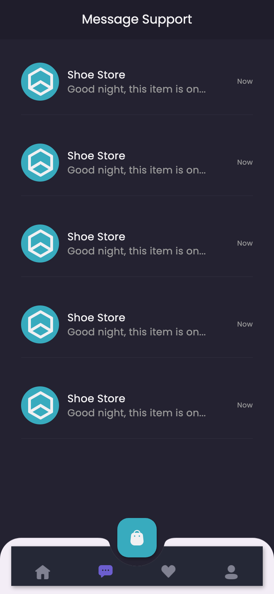
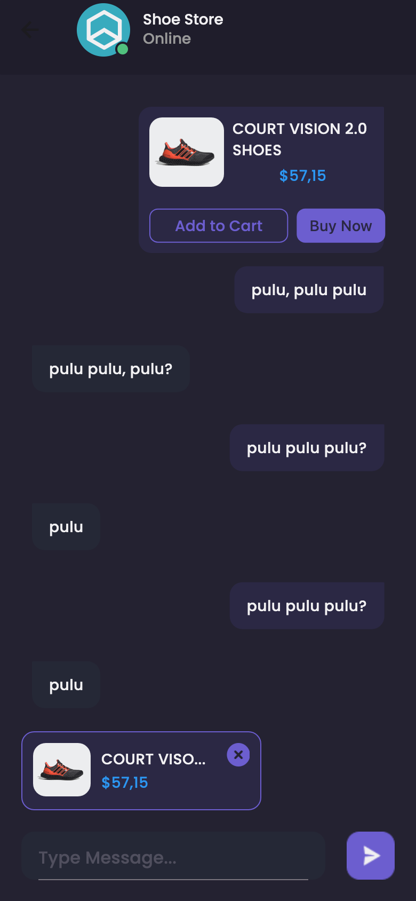
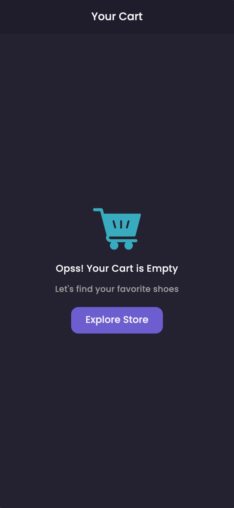
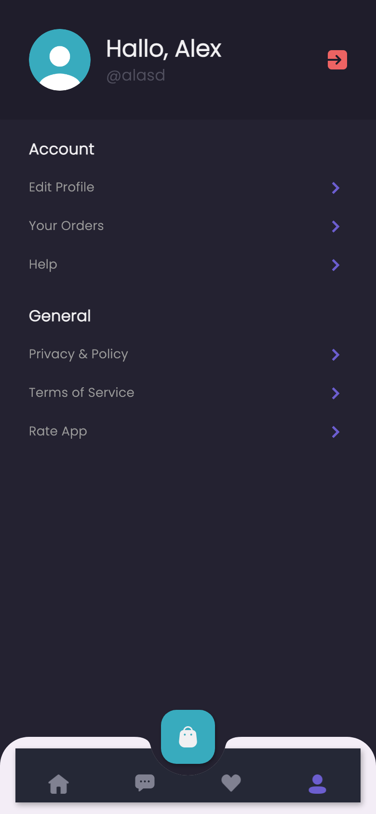

# Shamo – Shoe Store App (Flutter)

Shamo is a shoe store mobile app built with **Flutter**: browse shoes by category, open a product, add it to the cart or wishlist, and chat with the store. The screens use sample data; API integration with [shamo-backend](https://github.com/NoviIndraF/shamo-backend) is in progress.

<p>
  
  
  
  
</p>
<p>
  
  
  
  
</p>

## Screens

| Route | Screen |
|---|---|
| `/` | Splash |
| `/sign-in`, `/sign-up` | Login and registration forms |
| `/main` | Bottom navigation: Home, Chat, Wishlist, Profile, plus a cart button |
| `/product` | Product detail: image carousel, price, description, similar shoes, add to cart |
| `/cart` | Cart (empty state) |
| `/detail-chat` | Chat with the store, with a product preview in the message |
| `/edit-profile` | Edit name, username and email |

Home shows category filters, popular products and new arrivals.

## Tech stack

- Flutter, dark theme with `google_fonts` (Poppins)
- `carousel_slider` for product images
- `http` and `provider` for the upcoming API layer (`lib/services`, `lib/models`)

## Project structure

```
lib/
  main.dart        Routes
  theme.dart       Colours, text styles, margins
  pages/           sign_in, sign_up, splash, product, cart, detail_chat, edit_profile
    home/          main_page (bottom navigation), home, chat, wishlist, profile
  widgets/         product_cart, product_tile, chat_tile, chat_bubble, wishlist_card
  models/          User model
  services/        AuthService (work in progress)
assets/            images, icons, buttons
```

## Getting started

The project targets **Flutter 2.x** (Dart `>=2.15.1 <3.0.0`). Its `http ^0.12.2` and `provider ^4.3.3` constraints are not null-safe, so they need upgrading before the app builds with Flutter 3.

```bash
flutter pub get
flutter run
```
